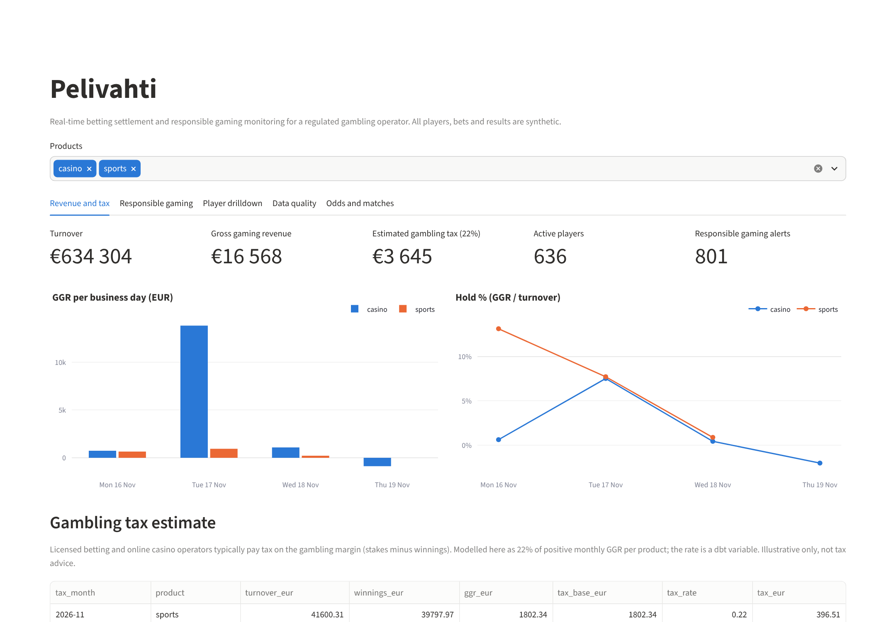
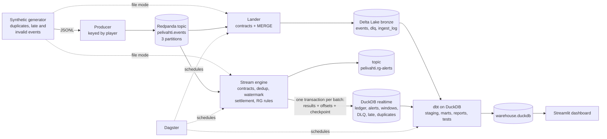
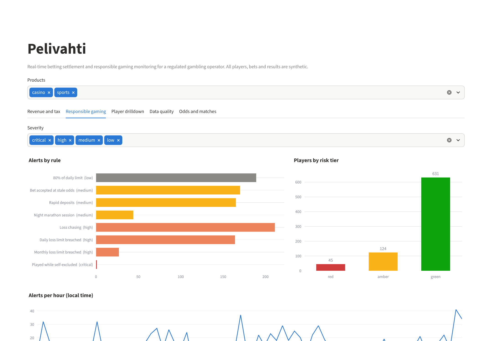
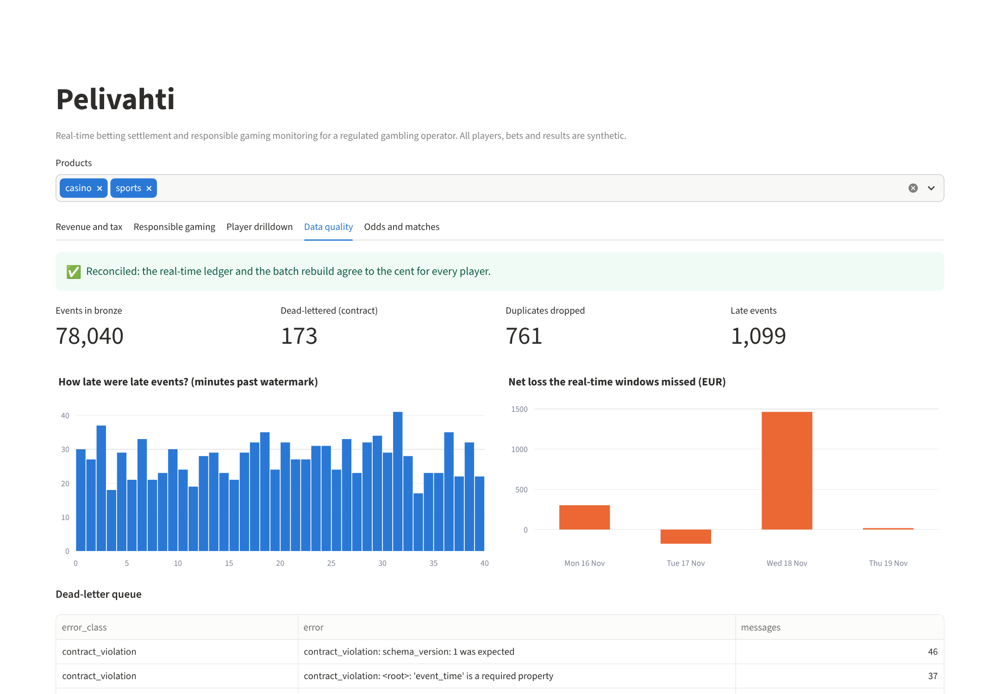
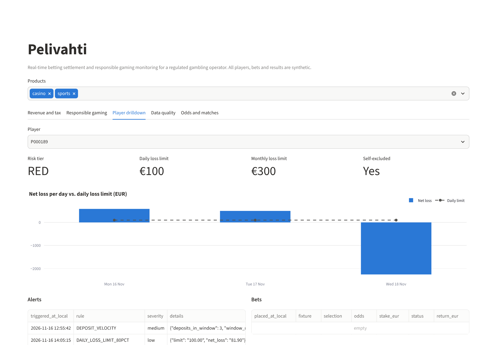
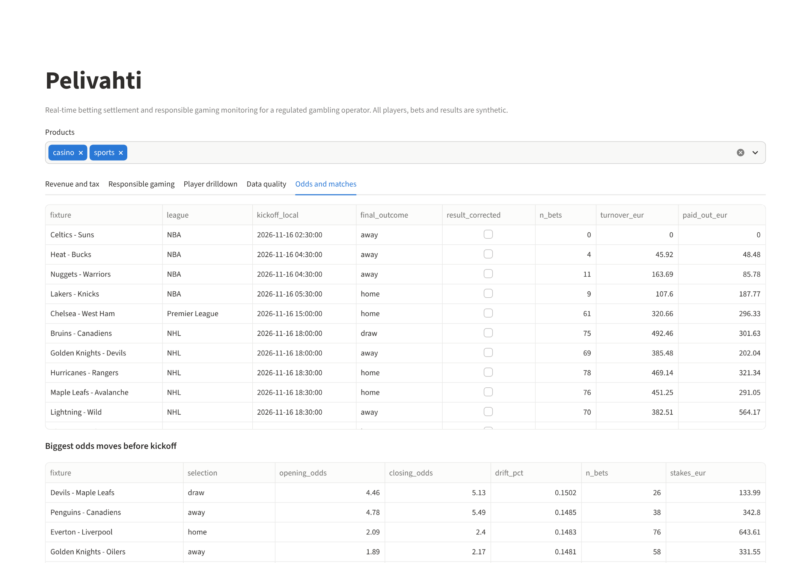

# Pelivahti: real-time betting settlement and responsible gaming pipeline

[](https://github.com/munyingi/pelivahti/actions/workflows/ci.yml)

Pelivahti is the data platform behind a regulated sports betting and online casino operator. Sports bets and casino rounds stream in, get settled into a wallet ledger in real time, are checked against responsible gaming rules within seconds, and land in a lakehouse that a dbt warehouse turns into revenue, tax and player-risk reporting.

Everything runs on free tools, on a laptop or in GitHub Actions. All players, bets and results are synthetic.

📄 **[Read the 4-page case study (PDF)](docs/Pelivahti_case_study.pdf)** for the problem, architecture, design decisions and results.

**Why this domain?** Licensed gambling is one of the hardest places to get data wrong. Every bet moves real money, results get corrected after payout, and regulators expect operators to spot harmful play quickly and to report revenue and gambling tax (modelled here as **22% of the gambling margin**, stakes minus winnings) that they can prove. A licensed operator needs exactly this: correct settlement, provable player protection and tax-ready numbers.



## What it demonstrates

| Data engineering concept | Where |
|---|---|
| **Event-time stream processing** with watermarks, tumbling day windows, sliding windows and session windows | [`stream/engine.py`](src/pelivahti/stream/engine.py) |
| **Exactly-once results** without Kafka transactions: results + source offsets + state checkpoint in one DB transaction, proven by a crash test | [`stream/runner.py`](src/pelivahti/stream/runner.py), [`test_exactly_once.py`](tests/test_exactly_once.py) |
| **Late data handling**: money is never dropped, late events skip closed windows and are logged; the batch layer measures the gap | engine + [`rpt_realtime_vs_batch_daily`](dbt/models/reports/rpt_realtime_vs_batch_daily.sql) |
| **Idempotency and deduplication** of at-least-once delivery (event_id + business keys + deterministic output ids) | engine, Delta MERGE |
| **Append-only financial ledger** with reversals for corrected match results | `_settle()` in the engine |
| **Data contracts**: versioned JSON Schemas, invalid messages to a dead-letter queue | [`contracts/v1`](contracts/v1), [`contracts.py`](src/pelivahti/contracts.py) |
| **Lakehouse table format**: Delta Lake bronze with ACID MERGE, time travel and compaction | [`lakehouse.py`](src/pelivahti/lakehouse.py) |
| **Lambda-style reconciliation**: the stream ledger and a batch rebuild from bronze must agree to the cent | [`assert_realtime_ledger_reconciles`](dbt/tests/assert_realtime_ledger_reconciles.sql) |
| **dbt modelling** on DuckDB: staging, effective-dated limits with an ASOF join, GGR and tax marts, 46 data tests | [`dbt/`](dbt) |
| **Kafka (Redpanda)** producer keyed by player, manual partition assignment, alerts topic | [`sources.py`](src/pelivahti/sources.py), [`docker-compose.yml`](docker-compose.yml) |
| **Orchestration** with Dagster assets wired to dbt sources, daily schedule | [`orchestration/definitions.py`](orchestration/definitions.py) |
| **CI** with lint, unit tests, a full pipeline run and an end-to-end Redpanda job | [`.github/workflows/ci.yml`](.github/workflows/ci.yml) |

## Architecture



Two independent consumers read the same events. The **stream engine** is the speed layer: it books money and raises alerts within one micro-batch. The **lander** is the source of truth: it validates and MERGEs every event into Delta Lake. dbt rebuilds the ledger from bronze on its own and **fails the build if the two disagree by a single cent**.

## The events

Ten event types, each with a JSON Schema contract in [`contracts/v1`](contracts/v1): `player_registered`, `limit_changed`, `self_exclusion_set`, `deposit`, `withdrawal`, `match_scheduled`, `odds_changed`, `bet_placed`, `match_result`, `casino_round`.

The generator simulates 800 players over three days (about 79,000 messages): casual, regular and at-risk profiles, NHL, Premier League and NBA fixtures with priced 1X2 markets and moving odds, a ~94.5% RTP casino, voided matches and corrected results. It then damages the stream on purpose, the way real transport does:

| Problem injected | Rate | How the pipeline handles it |
|---|---|---|
| Small delivery delays (out-of-order) | every event | event time + 5 min allowed lateness |
| Very late events (2 to 45 min) | 1.5% | booked to the ledger, skipped by closed windows, logged in `late_events` |
| Redelivered duplicates | 1% | dropped by event_id, logged in `duplicates`; bronze MERGE is idempotent |
| Contract violations, truncated JSON | 0.2% | dead-letter queue with the reason |
| Result corrections (`result_version` 2) | 2.5% of matches | REVERSAL entry plus a new settlement, never an update |

## Responsible gaming rules

| Rule | Severity | Window |
|---|---|---|
| Played while self-excluded | critical | none (checked even for late events) |
| Daily / monthly loss limit breached | high | local calendar day / month |
| Loss chasing: deposit within 10 min of a loss, then a stake of 2x the usual | high | 20 min after the deposit |
| Rapid deposits: 3 or more in 15 minutes | medium | sliding 15 min |
| Night marathon: a session of 90+ min touching 00:00 to 05:00 | medium | session window, 20 min gap |
| 80% of the daily loss limit reached | low | local calendar day |
| Bet accepted at stale odds (operations) | medium | odds valid at bet time |

Loss limits are effective-dated: lowering a limit applies at once, raising it waits 24 hours. Both the engine and the dbt model `int_player_limits` implement the same rule.



## Exactly-once, and how it is proven

Each micro-batch commits **in one DuckDB transaction**: the ledger rows, alerts, closed windows, DLQ, late and duplicate logs, the next offset per partition, and a pickled checkpoint of the engine state. Kafka offsets are never committed to Kafka. On restart the engine loads the checkpoint and seeks to the stored offsets. Every output row has a deterministic id and is written with `INSERT OR IGNORE`, so even a full replay changes nothing.

[`test_exactly_once.py`](tests/test_exactly_once.py) crashes the engine inside a transaction after three batches, restarts it, and asserts that every output table is **identical** to a clean run. A second test deletes the offsets and checkpoint, replays the whole stream on a finished database, and asserts nothing changed. Alerts sent to the `rg-alerts` topic are at-least-once after the commit, keyed by `alert_id` so consumers can deduplicate.

## Warehouse (dbt)

```
staging       stg_events, stg_bets, stg_casino_rounds, stg_deposits, ... (one per event type)
intermediate  int_match_final_results, int_bet_settlements, int_wallet_movements, int_player_limits
marts         dim_players, dim_matches, fct_sports_bets, fct_casino_rounds, fct_ggr_daily,
              fct_gambling_tax_monthly, fct_player_daily, fct_rg_alerts, fct_odds_movement
reports       rpt_realtime_vs_batch_ledger, rpt_realtime_vs_batch_daily, rpt_data_quality, ...
```

GGR is counted per local business day (time zone set by `PELIVAHTI_TIMEZONE`, default EET): sports bets on their settlement day (void and open bets excluded), casino rounds on their play day. The tax mart applies 22% to positive monthly GGR per product. It is an illustration of the rule, not tax advice.

Notable tests: the stream and batch ledgers reconcile per player and per bet, the GGR identity holds, tax equals rate times positive GGR, no bet is placed after kickoff, the stream never books a stake twice. `assert_every_daily_breach_was_alerted` is a **warning** on purpose: on the default seed it flags one player-day where late events pushed a player over the limit after the real-time window had closed. That gap is the cost of a 5-minute watermark, and the report makes it visible instead of hiding it.



## Dashboard

Five tabs, built on the dbt marts. Screenshots from the default run (seed 42):

| Revenue and tax | Responsible gaming |
|---|---|
|  |  |
| **Player drilldown** | **Data quality** |
|  |  |
| **Odds and matches** | |
|  | |

## Run it

Requires Python 3.11+. Docker is only needed for the Kafka mode.

```bash
git clone https://github.com/munyingi/pelivahti.git && cd pelivahti
python -m venv .venv && source .venv/bin/activate
make setup          # pip install -e ".[dashboard,orchestration,dev]"

make run            # generate -> Delta bronze -> stream -> dbt build (about 40 s)
make dashboard      # http://localhost:8501
make test           # 29 unit, recovery and idempotency tests
```

Through a real broker:

```bash
make kafka-up       # Redpanda on localhost:19092, Console on http://localhost:8080
make kafka-run      # generate, produce, land and stream from Kafka, then dbt build
make kafka-test     # integration tests: Kafka results must equal file results
make kafka-down
```

Orchestrated: `make dagster` and materialize all assets from http://localhost:3000.

Every step is also a CLI command: `pelivahti generate | produce | land | stream | dbt | run-local | reset`. Try `pelivahti stream --crash-after 5` and run it again without the flag to watch it resume.

### Deploy the dashboard for free

On [Streamlit Community Cloud](https://streamlit.io/cloud), create an app from this repo with `dashboard/app.py` as the entry point. On first start the app generates a smaller dataset and builds the warehouse itself (about a minute), so no data files are committed.

## Project layout

```
contracts/v1/          JSON Schema data contracts
src/pelivahti/         generator, contracts, sources (file/Kafka), lakehouse, stream engine, CLI
dbt/                   dbt project (DuckDB + Delta plugin), macros, tests
orchestration/         Dagster assets and schedule
dashboard/             Streamlit app
docs/                  case study PDF (rebuild: python docs/build_case_study.py), screenshots
tests/                 pytest: contracts, engine rules, exactly-once, Kafka end-to-end
```

## Design choices and limits

- **Python stream engine instead of Flink.** It implements the same semantics (event time, watermarks, keyed state, checkpoints tied to offsets) in about 500 readable lines that run anywhere, including CI. In production the same design maps to Flink with a transactional sink.
- **One engine instance.** Settlement needs bets (keyed by player) and results (keyed by match) together. At scale you would partition by player and broadcast match results to every partition.
- **Bronze dedupes on event_id.** Duplicates are counted, not stored, which keeps bronze small; a raw append-only landing zone would be the other option.
- **Late events never reopen a closed window.** The batch layer is the correction path, and the gap is reported.

## License

MIT
